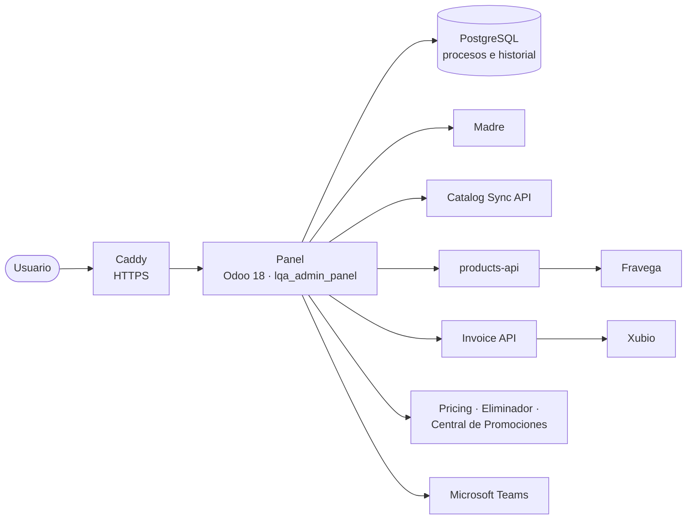

# Panel Interno

Panel de operación de **Tienda Lo Quiero Acá**, construido sobre Odoo 18.

Junta en un solo lugar el trabajo comercial (MercadoLibre, Automeli y los marketplaces Retailers) y el administrativo (facturación en Xubio). No guarda el catálogo, las órdenes ni los comprobantes: los consulta en el momento a los servicios internos —Madre, Catalog Sync, products-api, Invoice API— y registra lo que hace cada usuario.

## Qué hace

| Área | |
|---|---|
| **MercadoLibre** | Catálogo con rendimiento y filtros, carpetas de publicaciones (Selecciones), exportación a Excel, bajas en lote (Eliminador), rentabilidad y precio sugerido (Pricing) y Central de Promociones. |
| **Automeli** | Catálogo de productos con costos y estados, y carpetas de selección. |
| **Retailers** | Estado del catálogo en Fravega, órdenes de todos los marketplaces, publicación de productos en Fravega con seguimiento en vivo, y avisos de órdenes nuevas en Teams. |
| **Administración** | Alta de clientes, comprobantes, facturas y notas de crédito en Xubio, a través de Invoice API. |
| **Configuración** | Usuarios y permisos, y las direcciones y claves de los servicios. |

## Cómo está armado



El navegador solo habla con el panel. El panel llama a cada servicio con su credencial, así que las claves nunca llegan al navegador. El detalle está en [Rutas e integraciones](docs/api.md).

## Ambientes

| Ambiente | URL |
|---|---|
| Producción | `https://admin.loquieroaca.com` |
| Local | `http://localhost:8069` |

| Herramienta | Ruta | Para qué |
|---|---|---|
| Panel | `/odoo` | El panel. |
| Documentación | `/docs` | Esta documentación, navegable y con buscador. |
| Ajustes | `/odoo/settings` → *Panel Interno* | Direcciones, claves y tiempos de espera de los servicios. Solo administradores de Odoo. |
| Salud | `/lqa_admin_panel/health` | Confirma que el módulo está cargado (JSON-RPC, con sesión). |

## Acceso

Se entra con el usuario y la contraseña del panel. Hay dos permisos:

| Permiso | |
|---|---|
| **Usuario comercial** | Todas las secciones. |
| **Administrador del panel** | Además: Usuarios y permisos, acciones de la Central de Promociones, emitir notas de crédito, y ver y borrar los procesos de todos. |

Los usuarios se dan de alta en **Configuración → Usuarios**, sin depender del correo.

## Documentación

**Uso del panel**

| Documento | Qué explica |
|---|---|
| [Guía funcional](docs/funcional.md) | Qué se puede hacer en cada sección, con qué límites y quién puede hacerlo. |
| [Mensajes y motivos](docs/mensajes.md) | Qué significa cada aviso, por qué no se publicó un producto o no se facturó una venta, y qué hacer. |

**Integraciones**

| Documento | Qué explica |
|---|---|
| [Rutas e integraciones](docs/api.md) | Las rutas propias del panel y qué servicio interno llama cada sección, con qué credencial. |

**Técnico**

| Documento | Qué explica |
|---|---|
| [Arquitectura y configuración](docs/tecnico.md) | Capas del addon, qué guarda, procesos en segundo plano, todos los parámetros de configuración, permisos y limitaciones conocidas. |
| [Operación](docs/operacion.md) | Dónde corre, deploy, credenciales, backups y problemas frecuentes. |

## Desarrollo local

Requisitos: Docker.

```bash
docker compose up -d                # http://localhost:8069
```

Base de prueba con el addon instalado:

```bash
docker exec lqa-panel-odoo odoo -c /etc/odoo/odoo.conf -d lqa_panel_test -i lqa_admin_panel --stop-after-init --no-http
```

Después se entra con la base `lqa_panel_test`, usuario `admin` y contraseña `admin`.

Tests y validaciones (sin Odoo):

```bash
python3 -m unittest discover -s tests -v    # sitio de documentación
python3 deploy/check_signatures.py          # firmas de los métodos del addon
```

Para ver la documentación como sitio, sin levantar Odoo:

```bash
python3 scripts/preview_docs_site.py        # http://localhost:4310/docs
```

Un push a `main` despliega solo: ver [Operación](docs/operacion.md#deploy).

## Stack

Odoo 18 · Python 3.12 · OWL · SCSS · PostgreSQL 16 · Caddy · Docker Compose · GitHub Actions.
