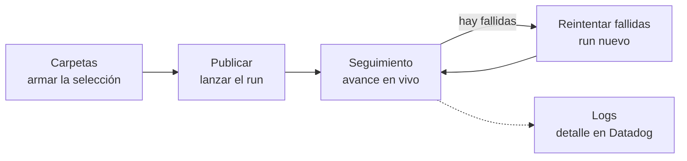

# Guía funcional

Qué se puede hacer en cada sección del panel, con qué límites y quién puede hacerlo.

← [Volver al inicio](../README.md)

**Contenido**

1. [Cómo se navega](#cómo-se-navega)
2. [MercadoLibre](#mercadolibre)
3. [Automeli](#automeli)
4. [Retailers](#retailers)
5. [Administración](#administración)
6. [Configuración](#configuración)
7. [Qué puede hacer cada perfil](#qué-puede-hacer-cada-perfil)

---

## Cómo se navega

El panel tiene tres áreas: **Comercial** (MercadoLibre, Automeli y Retailers), **Administración** (facturación en Xubio) y **Configuración** (usuarios y parámetros). Todo se recorre desde el menú de la izquierda.

- **Contraer el menú.** El botón « del pie lo reduce a una columna de íconos, para ganar ancho. Se recuerda en ese navegador.
- **Favoritos.** Cada sección tiene una estrella al lado. Las marcadas aparecen como accesos directos en el **Dashboard inicial**. Son personales: cada usuario tiene los suyos.
- **Avisos.** Lo que pasa después de una acción aparece arriba a la derecha: verde cuando salió bien, ámbar para algo a revisar, rojo para un error. Los errores quedan más tiempo en pantalla y se frenan si pasás el mouse por encima.

> El panel no guarda el catálogo ni las órdenes: los consulta en el momento a los servicios internos (Madre, Catalog Sync, Invoice, etc.). Si uno de esos servicios está caído, la sección que depende de él avisa "No se pudo conectar con… parece estar caído" a los pocos segundos, y el resto del panel sigue funcionando.

---

## MercadoLibre

### Catálogo de productos

Todas las publicaciones de la cuenta de Mercado Libre, con su rendimiento: precio, stock, facturación, órdenes, unidades vendidas, visitas y conversión.

**Filtros:** búsqueda por texto, marca, categoría, dominio, estado, condición, tipo de publicación, prefijo de SKU, mínimo de órdenes, mínimo de facturación, con o sin visitas, con o sin órdenes, y fecha de creación. Se puede ordenar por cualquiera de las métricas.

Con un filtro aplicado se puede:

| Acción | Qué hace | Límite |
|---|---|---|
| **Guardar en carpeta** | Guarda las publicaciones marcadas en una carpeta de [Selecciones](#selecciones). | — |
| **Guardar todo el filtro** | Guarda en una carpeta todo lo que devuelve el filtro, no solo la página visible. Corre en segundo plano y se puede cancelar. | 500.000 publicaciones |
| **Exportar a Excel** | Descarga el resultado del filtro sin pasar por una carpeta. Se eligen las columnas y en cuántas partes iguales dividirlo; llega un ZIP con un Excel por parte. | Hasta 20 partes |

La exportación corre en segundo plano: podés seguir usando el panel y volver a buscarla. Solo puede haber una exportación en curso por usuario, y el archivo queda disponible 7 días.

**Columnas exportables:** MLA, título, SKU, marca, estado, condición, tipo de publicación, precio, moneda, stock, facturación, órdenes, unidades vendidas, visitas, conversión de órdenes y de unidades, categoría, dominio, link, fecha de creación, última actualización, ventas de catálogo, ticket promedio, primera y última orden.

### Selecciones

Carpetas de publicaciones guardadas desde el catálogo o importadas desde un archivo. Sirven como punto de partida para otras secciones; por ejemplo, Pricing procesa una selección completa.

- **Importar MLAs desde un archivo.** Un CSV o Excel con una columna llamada **MLA** (se lee la primera hoja), de hasta 20 MB. El panel crea la carpeta y completa cada MLA con sus datos del catálogo. Al terminar muestra cuántos se agregaron, cuántos no se encontraron y cuántos eran inválidos. El proceso se puede **cancelar** y, si falló o se canceló, **reintentar** desde donde quedó.
- **Descargar CSV** con las columnas que elijas: básicas o todas.
- **Eliminar una carpeta** borra también sus publicaciones guardadas. Solo puede hacerlo quien la creó o un administrador del panel.

### Eliminador

Da de baja publicaciones de Mercado Libre en lote.

1. Cargás los MLAs a mano (uno por línea o separados por coma) o desde un CSV. El panel toma cualquier valor con formato `MLA` seguido de números y descarta el resto.
2. Escribís el **motivo del lote**, que es obligatorio y queda en el historial para auditoría, e indicás la **app key** de la aplicación de Mercado Libre con la que se eliminan.
3. Confirmás. Las publicaciones se envían en tandas de 1.000.

El **historial** guarda cada lote con quién lo ejecutó, el motivo y el resultado de cada MLA (eliminado o fallido, con el detalle). El motivo se puede editar después. Eliminar una publicación **no se puede deshacer**.

### Pricing

Calcula rentabilidad y **precio sugerido** de publicaciones de Mercado Libre. Hay tres formas de cargarlas:

| Forma | Qué se carga | Límite |
|---|---|---|
| **Selección completa** | Todas las publicaciones de una carpeta de Selecciones. Se procesa en lotes en segundo plano y termina en un **Excel consolidado**. | El tamaño de la carpeta |
| **CSV** | Columnas `mla`, `sku`, `tipo_publicacion`, `precio` y `categoria`. | 5.000 filas |
| **Carga manual** | Las mismas columnas, pegadas como CSV con encabezados o como lista JSON. | 5.000 filas |

Cada fila necesita MLA, categoría, tipo de publicación, SKU y precio de venta; si falta alguno, el panel indica qué filas lo tienen incompleto. El resultado muestra, por publicación, el precio sugerido, el profit y el margen, y se descarga en Excel. Los lotes con error se pueden **reintentar** sin repetir los que salieron bien. Cuando un proceso termina, el panel lo avisa aunque estés en otra sección (lo revisa cada 30 segundos).

Cada usuario ve sus propios procesos; un administrador del panel ve los de todos.

### Central de Promociones

La participación de las publicaciones en promociones de Mercado Libre, según la Central de Promociones (CPE).

| Pestaña | Qué muestra |
|---|---|
| **Central** | Cuántos MLAs y SKUs están alcanzados por cada tipo de promoción (SMART, DEAL, PRE_NEGOTIATED), con descarga en Excel, y el listado de promociones con estado, precios, rentabilidad y vigencia. |
| **Catálogo** | Las campañas disponibles y cuántos candidatos tiene cada una. |
| **Órdenes y aporte ML** | Cuánto aportó Mercado Libre en las ventas, por fecha y orden por orden. |
| **Acciones** | Procesos manuales de la central. **Solo administradores del panel.** |
| **Datadog** | Accesos a los logs en vivo de la central. |

Las **acciones** disponibles son:

| Acción | Qué hace |
|---|---|
| Sincronizar campañas | Trae de Mercado Libre el estado y los datos de las promociones. |
| Scheduler de activación | Activa las promociones que cumplen las reglas económicas. |
| Scheduler de desactivación | Saca de las promociones las publicaciones que ya no cumplen los criterios. |
| Reintentar desactivaciones fallidas | Reintenta las que quedaron con la desactivación fallida. |
| Sincronizar una campaña puntual | Actualiza una sola promoción, por su `promotionId`. |

Las acciones se ejecutan en segundo plano, así que la pantalla no se bloquea mientras la central procesa. Cada ejecución queda en el **historial**, con quién la pidió y el resultado.

---

## Automeli

### Catálogo

Los productos de Automeli tal como los registra Madre: costos (costo total, precio scrapeado, envío e impuestos), stock, peso, estado en Amazon y en Mercado Libre, motivo de pausa y fechas de actualización. Arriba se ve cuándo se actualizó el catálogo por última vez.

Tiene filtros básicos y avanzados para cada uno de esos datos: valor exacto, mínimo o máximo, según el campo. Los productos se pueden guardar en una carpeta de Selecciones marcándolos de a uno, o con todo el filtro si devuelve hasta 10.000 productos.

### Selecciones

Las carpetas de Automeli. Se puede ver el detalle, **descargar un CSV con los MLAs** y eliminar la carpeta. Solo puede eliminarla quien la creó o un administrador del panel.

---

## Retailers

Retailers son los marketplaces fuera de Mercado Libre. Hoy el canal activo es **Fravega**.

### Marketplaces y Fravega

**Todos los marketplaces** muestra las tarjetas de los canales. La pantalla de **Fravega** tiene tres pestañas:

| Pestaña | Qué muestra |
|---|---|
| **Products** | Los productos publicados en Fravega: precio, stock, estado e imágenes, con filtro por estado. **Descargar pricing** baja un Excel con los SKUs del canal. |
| **Imports** | El historial de sincronizaciones del catálogo (productos, stock y precios): avance, lotes, procesados y fallidos. |
| **Status** | Cómo se reparten las publicaciones entre los distintos estados. |

### Catálogo

Busca un **seller SKU** y muestra cómo está en cada marketplace: SKU del canal, ID externo, precio, stock, estado y última actualización. Debajo está el listado completo, paginado.

### Órdenes

Las órdenes de todos los marketplaces, leídas de Madre.

- **Filtros:** búsqueda (orden, cliente, documento o TLQV), marketplace, rango de fechas y estado.
- **Estados:** Pendiente, Procesada en Floxu, Completada, Cancelada y Fallida.
- **Detalle:** al hacer clic en una orden se abre con todos sus datos: cliente, ítems, importes y el TLQV asociado.

### Publicador

Publica productos de Mercado Libre en Fravega. El recorrido es **Carpetas → Publicar → Seguimiento**, y **Logs** sirve para investigar casos puntuales.

**Carpetas.** Cada carpeta agrupa los productos a publicar, identificados por **MLA y SKU**. Se cargan uno por uno o desde un Excel (columnas `MLA` y `SKU`), y hay una plantilla para bajar. La lista muestra cuántos productos tiene cada carpeta. Se pueden sacar productos de una carpeta o **eliminarla entera**: eso borra la carpeta y sus productos **de forma permanente**, y si tiene productos pide escribir su nombre para confirmar.

**Publicar.** Elegís la carpeta y el destino, que hoy es solo Fravega. El resumen muestra cuántas publicaciones se van a crear y una **duración mínima estimada**: Fravega procesa hasta 30 SKU por minuto, así que 1.000 SKU tardan al menos media hora. Con carpetas grandes, crear la publicación tarda unos segundos; el botón queda bloqueado mientras tanto para no lanzar dos.

**Seguimiento.** Abre el run recién lanzado (o el último) y lo actualiza solo cada 4 segundos mientras queda algo en curso. Muestra el avance y el resultado de cada SKU:

| Resultado | Qué significa |
|---|---|
| **Publicado** | Quedó en Fravega; se ve el ID que le asignó Fravega. |
| **Omitido** | No se publicó, pero **no es un error**: ya estaba publicado, no tenía stock, la publicación de Mercado Libre estaba pausada, etc. |
| **Fallido** | No se pudo publicar, por ejemplo por falta de un dato obligatorio. |
| **En curso** | En cola o publicándose. Si falla por algo temporal, se reintenta solo hasta 3 veces. |

Cada SKU trae el motivo en palabras ("Ya está publicado en Fravega", "No hay categoría equivalente en Fravega"), con el código y el paso donde se cortó. El catálogo de motivos está en [Mensajes y motivos](mensajes.md#motivos-de-publicación).

**Reintentar fallidas.** Cuando el run terminó y tiene fallidos, este botón crea un **run nuevo** solo con esos SKU. Descarta los que mientras tanto ya quedaron publicados, y el run original no cambia. Algunos van a volver a fallar si el motivo sigue igual (por ejemplo, si Fravega sigue sin categoría para ese producto).

**Logs.** Lista los runs recientes y abre Datadog ya filtrado por run, con todos los resultados o solo omitidos y fallidos. Se puede buscar cualquier run por su número. Datadog se abre con la sesión de cada uno.

### Avisos de órdenes en Teams

Cada 5 minutos, el panel revisa las órdenes nuevas de Fravega y publica un resumen en un canal de Microsoft Teams. Se configura en Ajustes: activar o no, el webhook del canal, el período a mirar (últimas 24, 48 o 72 horas), qué estados avisar y cuántas órdenes entran por mensaje (20 por defecto). Una orden ya avisada no se repite.

---

## Administración

Facturación de las ventas (TLQV) en Xubio. El panel no factura por su cuenta: le pide cada operación a **Invoice API** y muestra el resultado. Cómo decide Invoice API si una venta se factura está en su propia documentación.

| Sección | Para qué |
|---|---|
| [Clientes](#clientes) | Dar de alta en Xubio a los compradores de una venta. |
| [Comprobantes](#comprobantes) | Consultar, exportar y respaldar en PDF lo que hay en Xubio. |
| [Facturación](#facturación) | Emitir facturas, de a una o en lote, y ver por qué no salieron. |
| [Notas de crédito](#notas-de-crédito) | Anular facturas emitidas. |

### Clientes

- **Clientes con CUIT o CUIL.** Desde los códigos TLQV, pegados a mano o en un CSV con una columna `tlqv`, `codigo_tlqv`, `orden` o similar. Invoice API busca al comprador en Xubio y, si no existe, lo crea con sus datos fiscales. Hasta 2.000 códigos por lote.
- **Consumidor final con DNI.** Cuando AFIP/ARCA no tiene datos fiscales del comprador, la venta queda como *issue*. Desde **Clientes con issue** se crea como consumidor final con su DNI, nombre y email.
- **Registros.** Cada lote queda guardado con su resultado.

### Comprobantes

El espejo de los comprobantes de Xubio que mantiene Madre: facturas, notas de crédito y notas de débito.

- **Filtros:** número, cliente, orden de Mercado Libre, tipo y rango de fechas.
- **Exportar a Excel**, eligiendo las columnas (recomendadas o todas), hasta 20.000 filas.
- **PDF** de un comprobante, generado y guardado en el CDN.
- **Actualizar comprobantes** (en Acciones): vuelve a traer de Xubio los comprobantes de un rango de fechas. Ya corre solo de forma periódica en Invoice API; sirve para recargar un período puntual.

### Facturación

**Crear facturas**, de dos maneras:

| Modo | Qué hace |
|---|---|
| **Individual** | Un TLQV. **Simular** arma la factura y la muestra sin emitirla; **Crear en Xubio** la emite. |
| **Masiva** | Una lista de TLQV, pegada o desde un archivo. Se encolan en Invoice API y se procesan en segundo plano. También se pueden encolar solo como simulación. |

La **fecha del comprobante** puede ser hoy o hasta 10 días atrás.

- **Seguimiento de cola:** el avance de un lote y el resultado de cada TLQV. Mientras el lote está en curso se actualiza solo cada 5 segundos (se puede pausar).
- **Comprobantes fallidos:** las ventas que no se pudieron facturar, con el motivo. Se filtran por motivo y por estado (abierto, resuelto, ignorado). Los motivos están en [Mensajes y motivos](mensajes.md#facturación-en-xubio).

> Una factura emitida **queda sin CAE**: el CAE se pide a mano en Xubio.

### Notas de crédito

Anula facturas ya emitidas. **Solo administradores del panel.**

1. Cargás los TLQV (hasta 200 por lote) y **previsualizás**: el panel muestra qué nota de crédito saldría para cada uno, sin emitir nada.
2. Confirmás la emisión. Es una confirmación explícita, porque **anular no se deshace**.
3. Las que no se pudieron emitir aparecen en **Bloqueadas**, con el motivo.

> **El orden importa.** La nota sale **sin CAE**, y el CAE se pide a mano en Xubio. Para corregir una factura: **nota de crédito → pedir el CAE → recién ahí editar la ficha del cliente → facturar de nuevo**. Si editás la ficha antes de pedir el CAE, AFIP rechaza la nota.

---

## Configuración

### Usuarios y permisos

Alta y edición de los accesos al panel, sin depender del correo: la contraseña se define en la misma pantalla.

- **Permisos:** *Usuario comercial* o *Administrador del panel*.
- La contraseña tiene que tener al menos 8 caracteres.
- Un usuario se puede desactivar sin borrarlo.
- Nadie puede quitarse a sí mismo el permiso de administrador.

Solo los administradores del panel ven esta sección.

### Ajustes

Las direcciones de los servicios internos, sus claves y los tiempos de espera. Se cargan en **Ajustes → Panel Interno**, y solo puede entrar un administrador de Odoo. El detalle de cada parámetro está en [Arquitectura y configuración](tecnico.md#configuración).

---

## Qué puede hacer cada perfil

| | Usuario comercial | Administrador del panel |
|---|---|---|
| Usar MercadoLibre, Automeli, Retailers y Administración | ✓ | ✓ |
| Ver procesos (Pricing, Selecciones, lotes de facturación) | Los propios | Los de todos |
| Eliminar carpetas de Selecciones | Las propias | Todas |
| Ejecutar acciones de la Central de Promociones | — | ✓ |
| Emitir notas de crédito | — | ✓ |
| Usuarios y permisos | — | ✓ |

Ajustes es aparte: requiere ser administrador de Odoo, no alcanza con administrador del panel.
