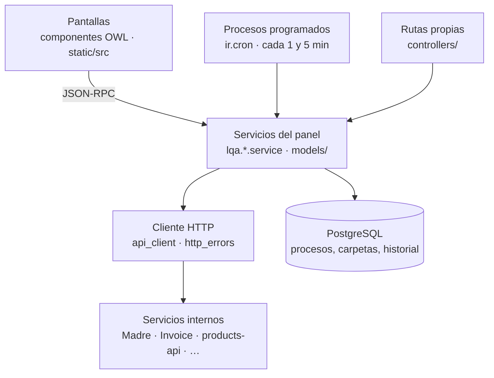

# Arquitectura y configuración

Cómo está armado el panel por dentro, qué guarda, qué corre en segundo plano y cómo se configura.

← [Volver al inicio](../README.md)

**Contenido**

1. [Capas](#capas)
2. [Dónde está cada cosa](#dónde-está-cada-cosa)
3. [Qué guarda el panel](#qué-guarda-el-panel)
4. [Procesos en segundo plano](#procesos-en-segundo-plano)
5. [Configuración](#configuración)
6. [Permisos](#permisos)
7. [Interfaz](#interfaz)
8. [Sitio de documentación](#sitio-de-documentación)
9. [Validaciones y tests](#validaciones-y-tests)
10. [Limitaciones conocidas](#limitaciones-conocidas)

---

## Capas

El panel es un addon de Odoo 18, `lqa_admin_panel`. Odoo aporta el login, los permisos, la base de datos y el servidor web. Todo lo demás —las pantallas, la navegación, las integraciones— es código propio del addon.



| Capa | Qué hace |
|---|---|
| **Pantallas** | Cada sección es una acción cliente de Odoo (`ir.actions.client`) con un componente OWL: JS, template XML y SCSS en `static/src/`. |
| **Servicios del panel** | Modelos abstractos (`AbstractModel`) con la lógica de cada área. No guardan datos: verifican permisos, validan lo que llega, llaman a los servicios internos y normalizan la respuesta. |
| **Cliente HTTP** | `lqa.api.client` hace las llamadas; `http_errors.py` traduce las fallas a mensajes en castellano y separa el tiempo de conexión (5 s) del de respuesta. |
| **Modelos persistentes** | Lo que el panel sí guarda: procesos, carpetas propias e historial. |
| **Procesos programados** | Continúan en segundo plano las tareas largas. |
| **Rutas propias** | Descargas, salud y documentación. Ver [Rutas e integraciones](api.md#rutas-propias). |

---

## Dónde está cada cosa

```
addons/lqa_admin_panel/
  __manifest__.py          versión del módulo y lista de assets
  docs_site.py             sitio de documentación (sin Odoo)
  controllers/
    main.py                salud, manifiesto, descargas (CSV, ZIP, XLSX, PDF)
    docs.py                /docs
  models/                  servicios y modelos (ver abajo)
  data/                    procesos programados y branding
  security/                grupos y permisos de acceso
  views/                   menús, acciones y Ajustes
  static/src/
    js/  xml/  scss/       una terna por pantalla, más navegación y avisos
docs/                      esta documentación
tests/                     tests del sitio de documentación
scripts/                   vista previa local de la documentación
deploy/                    deploy, backup, bootstrap, Caddy, validación de firmas
config/                    configuración de Odoo
```

**Servicios del panel**

| Servicio | Archivo | Sección |
|---|---|---|
| `lqa.dashboard.service` | `dashboard_service.py` | Dashboard inicial y favoritos |
| `lqa.mercadolibre.catalog.service` | `mercadolibre_catalog_service.py` | Catálogo, Selecciones y exportación |
| `lqa.mercadolibre.deletion.service` | `mercadolibre_deletion.py` | Eliminador |
| `lqa.mercadolibre.pricing.service` | `mercadolibre_pricing.py` | Pricing |
| `lqa.mercadolibre.promotions.service` | `mercadolibre_promotions_service.py` | Central de Promociones |
| `lqa.automeli.catalog.service` | `automeli_catalog_service.py` | Automeli |
| `lqa.retailers.service` | `retailers_service.py` | Marketplaces, catálogo de Retailers y Órdenes |
| `lqa.retailers.publisher.service` | `retailers_publisher_service.py` | Publicador |
| `lqa.accounting.service` | `accounting_arca.py` | Administración |
| `lqa.user.management.service` | `user_management_service.py` | Usuarios y permisos |

**Pantallas** (`static/src/js/`): `mercadolibre_catalog`, `mercadolibre_selections`, `mercadolibre_deleter`, `mercadolibre_pricing`, `mercadolibre_promotions`, `automeli_catalog`, `automeli_selections`, `retailers`, `retailers_catalog`, `retailers_orders`, `retailers_publisher` (Carpetas), `retailers_publisher_execute` (Publicar), `retailers_publisher_tracking` (Seguimiento), `retailers_publisher_logs` (Logs), `accounting`, `user_management` y `dashboard`. Además, `navigation.js` (el menú lateral), `feedback.js` (avisos y diálogos de error) y `mercadolibre_pricing_notifications.js` (el aviso global de Pricing).

---

## Qué guarda el panel

El panel no guarda el catálogo, las órdenes ni los comprobantes: los consulta en el momento. Lo que sí guarda en su base:

| Modelo | Qué es |
|---|---|
| `lqa.mercadolibre.selection.folder` · `.item` | Carpetas de Selecciones de MercadoLibre y sus publicaciones. |
| `lqa.mercadolibre.selection.job` | Guardados masivos e importaciones de MLAs, con su avance. |
| `lqa.mercadolibre.catalog.query` | Consultas largas al catálogo, que el navegador sigue por número. |
| `lqa.mercadolibre.catalog.export` | Exportaciones del catálogo a Excel; el ZIP vive en disco 7 días. |
| `lqa.mercadolibre.deletion.batch` · `.line` | Historial del Eliminador: lote, motivo, usuario y resultado por MLA. |
| `lqa.mercadolibre.pricing.job` · `.import` · `.item` | Procesos de Pricing y su resultado. |
| `lqa.mercadolibre.promotion.action.log` | Historial de acciones de la Central de Promociones. |
| `lqa.automeli.selection.folder` · `.item` | Carpetas de Automeli. |
| `lqa.retailers.publication.run` | Historial de publicaciones lanzadas desde el panel. Las carpetas y los runs viven en Madre. |
| `lqa.retailers.teams.notification` | Órdenes ya avisadas a Teams, para no repetirlas; se limpian a los 45 días. |
| `lqa.accounting.tlqv.client.job` · `.line` | Lotes de alta de clientes. |
| `lqa.accounting.invoice.creation.job` · `.invoice.batch` · `.nota.credito.batch` | Registros de facturación y notas de crédito pedidas desde el panel. |
| `lqa.panel.module` · `.section` | Las tarjetas del dashboard inicial. |

Los favoritos de cada usuario se guardan como parámetro de sistema (`lqa_admin_panel.favorite_menu_ids.user_<id>`).

---

## Procesos en segundo plano

| Proceso | Cada | Qué continúa |
|---|---|---|
| MercadoLibre: continuar selecciones masivas | 1 min | Guardar todo un filtro en una carpeta e importar MLAs desde un archivo. |
| MercadoLibre: continuar exportaciones del catálogo | 1 min | Las exportaciones a Excel. |
| LQA MercadoLibre Pricing Jobs | 1 min | Los lotes de Pricing por selección y la generación del Excel consolidado. |
| LQA Retailers Teams Order Notifications | 5 min | Los avisos de órdenes nuevas a Teams. |

Además, algunas tareas arrancan en un **hilo aparte** del servidor para no frenar la pantalla: la consulta larga al catálogo, el primer ciclo de un guardado masivo, los lotes de Pricing y las acciones de la Central de Promociones.

**Cómo se evita procesar dos veces lo mismo.** Las selecciones masivas y las exportaciones del catálogo se toman con un `UPDATE … RETURNING` condicional y un token propio. Mientras trabajan, dejan una marca de vida; si no la renuevan durante 5 minutos, otro proceso puede retomarlas. Cada lote se confirma por separado, así que un corte no rehace lo ya guardado, y reintentar una selección retoma desde donde quedó. Pricing no tiene este mecanismo.

> Odoo corre con **2 workers** y **1 hilo de cron**. Una llamada colgada a un servicio externo ocupa un worker entero; por eso toda llamada corta en 5 segundos si no logra conectar.

---

## Configuración

Cada valor se resuelve en este orden: **Ajustes → variable de entorno → valor por defecto**. Lo cargado en Ajustes gana. En Ajustes, las claves son campos de contraseña: no se muestran.

Los parámetros se guardan como `lqa_admin_panel.<clave>`. Ajustes está en **Ajustes → Panel Interno**, y solo puede entrar un administrador de Odoo.

### MercadoLibre

| Ajuste | Clave | Variable | Por defecto |
|---|---|---|---|
| URL catálogo MercadoLibre | `mercadolibre_catalog_url` | — | `https://catalog-meli.loquieroaca.com/analytics/products/performance` |
| URL eliminador | `mercadolibre_delete_url` | `LQA_MERCADOLIBRE_DELETE_URL` | `https://api.meli.loquieroaca.com/meli/products/bulk/delete` |
| Clave interna eliminador | `mercadolibre_delete_api_key` | `LQA_MERCADOLIBRE_DELETE_API_KEY` | — |
| URL Pricing | `mercadolibre_pricing_url` | `LQA_MERCADOLIBRE_PRICING_URL` | `https://api.price.loquieroaca.com/internal/getProfit/details/bulk` |
| API key Pricing | `mercadolibre_pricing_api_key` | `LQA_MERCADOLIBRE_PRICING_API_KEY` | — |
| Timeout Pricing | `mercadolibre_pricing_timeout_seconds` | `LQA_MERCADOLIBRE_PRICING_TIMEOUT_SECONDS` | 300 |

### Central de Promociones

| Ajuste | Clave | Variable | Por defecto |
|---|---|---|---|
| API key (CPE) | `mercadolibre_promotions_api_key` | `LQA_MERCADOLIBRE_PROMOTIONS_API_KEY` | — |
| URLs de stats, promociones y catálogo | `mercadolibre_promotions_stats_url` · `_url` · `_catalogs_url` | — | `http://cpe.loquieroaca.com/promotions/…` |
| URLs de acciones | `…_sync_url` · `_activate_url` · `_deactivate_url` · `_deactivate_failed_url` · `_sync_one_url` | — | `http://cpe.loquieroaca.com/promotions/…` |
| URLs de aporte ML | `mercadolibre_aporte_orders_url` · `_analytics_url` | — | `https://api.madre.loquieroaca.com/api/mercadolibre/orders/…` |
| Timeout | `mercadolibre_promotions_timeout_seconds` | — | 120 |
| Timeout de acciones | `mercadolibre_promotions_action_timeout_seconds` | — | 300 |
| Datadog: URL y servicio | `mercadolibre_promotions_datadog_base_url` · `_service` | — | `https://us5.datadoghq.com/logs/livetail` · `central-promos-enginee` |

### Automeli

| Ajuste | Clave | Por defecto |
|---|---|---|
| URL catálogo | `automeli_catalog_url` | `https://api.madre.loquieroaca.com/api/automeli/product-snapshots/all` |
| URL estado del catálogo | `automeli_catalog_status_url` | `…/product-snapshots/last-updated` |

### Retailers y Publicador

| Ajuste | Clave | Variable | Por defecto |
|---|---|---|---|
| URL Madre | `retailers_madre_api_url` | `NEXT_PUBLIC_MADRE_API_URL` | `https://api.madre.loquieroaca.com` |
| Token Madre | `retailers_madre_api_token` | `LQA_RETAILERS_MADRE_API_TOKEN`, y si falta, el token interno general | — |
| URL Products | `retailers_products_api_url` | `NEXT_PUBLIC_PRODUCTS_API_URL` | `https://api.products.loquieroaca.com` |
| API key Products API | `retailers_products_api_key` | `LQA_PRODUCTS_API_KEY` | — |
| URL Orders | `retailers_orders_proxy_url` | `NEXT_PUBLIC_ORDERS_API_URL`, `ORDERS_API_URL` | `https://order.api.loquieroaca.com/orders` |
| Token Orders | `retailers_orders_api_token` | `ORDERS_API_TOKEN` (`LQA_ORDERS_API_TOKEN` ⚠) | — |
| URL Marketplace | `retailers_marketplace_api_url` | (`MARKETPLACE_API_URL` ⚠) | `https://api.marketplace.loquieroaca.com` |
| Timeout Retailers | `retailers_timeout_seconds` | — | 60 |
| Timeout Orders | `retailers_orders_timeout_seconds` | — | 90 |

### Avisos de Teams

| Ajuste | Clave | Variable | Por defecto |
|---|---|---|---|
| Activar | `retailers_teams_notifications_enabled` | — | Desactivado |
| Webhook | `retailers_teams_webhook_url` | (`LQA_TEAMS_WEBHOOK_URL` ⚠) | — |
| Período | `retailers_teams_orders_mode` | (`LQA_TEAMS_ORDERS_MODE` ⚠) | Últimas 24 h |
| Estados a avisar | `retailers_teams_order_statuses` | (`LQA_TEAMS_ORDER_STATUSES` ⚠) | Todos |
| Máximo por mensaje | `retailers_teams_max_orders_per_message` | — | 20 |
| Timeout | `retailers_teams_timeout_seconds` | — | 20 |
| Retención del registro | `retailers_teams_retention_days` | — | 45 días |

Ajustes también tiene dos botones: mandar un aviso de prueba y mandar las órdenes ahora.

### Administración

| Ajuste | Clave | Variable | Por defecto |
|---|---|---|---|
| URL Invoice ARCA | `accounting_invoice_api_url` | `LQA_ACCOUNTING_INVOICE_API_URL` | `https://invoice.loquieroaca.com` |
| Clave interna Invoice ARCA | `accounting_invoice_api_key` | `LQA_ACCOUNTING_INVOICE_API_KEY` | — |
| URL Madre Contable | `accounting_madre_api_url` | `LQA_ACCOUNTING_MADRE_API_URL` | `https://api.madre.loquieroaca.com` |
| Clave interna Madre Contable | `accounting_madre_api_key` | `LQA_ACCOUNTING_MADRE_API_KEY`, `LQA_INTERNAL_API_KEY` | — |
| Timeout Contable | `accounting_timeout_seconds` | — | 120 |

### Documentación

| Variable | Para qué |
|---|---|
| `DOCS_SITE_USER` · `DOCS_SITE_PASSWORD` | Con las dos, `/docs` pide usuario y clave y publica también Operación. |
| `DOCS_SITE_ENABLED` | `false` apaga `/docs`. Por defecto está encendido. |
| `DOCS_SITE_ROOT` | De dónde lee el README y `docs/`. Por defecto `/mnt/docs`, donde los monta el compose. |

> **⚠ Variables que no llegan al contenedor.** El código lee las marcadas con ⚠, pero `docker-compose.prod.yml` no se las pasa a Odoo: cargarlas en `.env.production` no tiene efecto, y en producción esos valores solo se configuran desde Ajustes. Lo mismo pasa con `LQA_MERCADOLIBRE_DELETE_CHUNK_SIZE`, `LQA_FRAVEGA_VTEX_ORDERS_URL` y `LQA_API_BASE_URL`.

Las variables de entorno se cargan en `.env.production` (no está en git) **con el formato `CLAVE=valor`, desde la columna 0**. Una línea con sangría o con `CLAVE: valor` se ignora sin aviso. Después de cambiar una variable hay que **recrear** el contenedor: reiniciarlo no alcanza. Ver Operación.

---

## Permisos

Dos grupos, en la categoría *Panel Comercial*:

| Grupo | Qué habilita |
|---|---|
| **Usuario comercial** | Todo el menú del panel. |
| **Administrador del panel** | Lo anterior, más: Usuarios y permisos, acciones de la Central de Promociones, emitir notas de crédito, y ver y borrar los procesos y carpetas de todos. |

El administrador de Odoo (`base.group_system`) hereda *Administrador del panel*, y es el único que entra a Ajustes.

Los permisos se verifican en el servidor: cada método público de un servicio llama a `_check_access()` antes de hacer nada. Ocultar un botón en la pantalla nunca es la única barrera.

---

## Interfaz

- **Menú lateral** (`navigation.js`): reemplaza la barra de Odoo. Marca la pantalla abierta a partir de la acción en curso, no del último clic, así que funciona también al entrar por URL, con F5 o con atrás/adelante. Se puede contraer, y lo recuerda en el navegador.
- **Navegación instantánea.** Las vistas no esperan sus datos para dibujarse: aparecen con su estado de carga y los datos llegan después. Al abrir el panel, en un momento ocioso, se precargan las definiciones de todas las secciones del menú, para que el primer clic no espere. La carga se indica con una línea fina arriba que no tapa ni bloquea.
- **Avisos** (`feedback.js`): los toasts de Odoo llevan un ícono por tipo y una duración según la gravedad (un error, 9 s; un "listo", 3,5 s). Los diálogos de error dicen su título en castellano.
- **Estilos:** cada pantalla tiene su SCSS. El Publicador comparte una base (`.o_lqa_pubf`) entre sus cuatro vistas. libsass no acepta `min()`/`max()` de CSS con unidades mezcladas: rompe la compilación de todos los estilos.

---

## Sitio de documentación

`/docs` sirve esta documentación como sitio, con menú y buscador (Docsify). La lógica está en `docs_site.py`, que no depende de Odoo: lo usan la ruta de Odoo, la vista previa local y los tests.

- Solo sirve una **lista fija** de archivos: `README.md` y las cinco páginas de `docs/`. Nada más del repo se puede pedir, aunque exista.
- Las rutas copian la estructura del repo (README en la raíz, el resto en `docs/`): así los enlaces relativos funcionan igual en el sitio y en GitHub.
- El markdown se lee en cada pedido. En el servidor, `docs/` está montado como carpeta y se actualiza en caliente; `README.md` está montado como archivo suelto y se actualiza al reiniciar Odoo (el deploy reinicia cuando cambia).
- Los títulos de los `.md` **no pueden empezar con un número**: Docsify le antepone `_` al identificador, y el enlace funciona en GitHub pero no en el sitio.

Vista previa local, sin levantar Odoo:

```bash
python3 scripts/preview_docs_site.py    # http://localhost:4310/docs
```

Con `DOCS_SITE_USER` y `DOCS_SITE_PASSWORD` en el entorno, la vista previa pide credenciales y muestra también Operación.

---

## Validaciones y tests

Cada push a `main` pasa primero por estas validaciones. Si alguna falla, no se despliega.

| Validación | Qué atrapa |
|---|---|
| Python compila | Errores de sintaxis. |
| XML bien formado | Templates y vistas rotos. |
| SCSS compila con libsass | Lo que rompería todos los estilos del panel. |
| JS parsea como módulo | Errores de sintaxis en JS. Se valida como ESM, porque `node --check` sobre un `.js` lo lee como CommonJS y deja pasar errores. |
| Firmas de métodos (`deploy/check_signatures.py`) | Llamadas a `self.método(…)` con argumentos que no coinciden con su definición. |
| Tests del sitio de documentación | Que `/docs` solo sirva su lista, respete las credenciales y arme bien el menú. |

```bash
python3 -m unittest discover -s tests -v
```

El addon no tiene una suite de tests de Odoo. La verificación de las pantallas se hace en el navegador después de cada deploy.

---

## Limitaciones conocidas

- **El filtro de motivos de Comprobantes fallidos está desactualizado.** El panel valida el filtro contra su propia lista, que no incluye nueve motivos que hoy emite Invoice API: `TLQV_SALE_CANCELLED`, `TLQV_COMISIONES_FLETE_MISSING`, `INVOICE_TOTAL_SALE_PRICE_MISMATCH`, `XUBIO_INVOICE_OUTCOME_UNKNOWN`, `ANTI_DUMPING_NOT_SUPPORTED`, `CLIENT_FLOW_BLOCKED`, `SOURCE_DATA_NOT_AVAILABLE`, `XUBIO_EXISTING_CLIENT_NOT_FOUND` e `INVOICE_CREATION_REPOSITORY_NOT_CONFIGURED`. Esas ventas aparecen con el filtro en "Todos", pero no se pueden filtrar. Al revés, el filtro ofrece tres motivos que Invoice no documenta: `TLQV_INVOICE_FLOW_BLOCKED`, `TLQV_INVOICE_JOB_FAILED` y `XUBIO_CLIENT_ALREADY_EXISTS`.
- **Ajustes que no se usan.** *URL Pricing Retailers*, *API key Pricing Retailers* y *Timeout Pricing Retailers* no los lee ningún código: quedaron del Pricing de Retailers, que se sacó. Lo mismo con sus variables `LQA_RETAILERS_PRICING_*`, que el compose sigue pasando. *URL base API*, *Ruta MercadoLibre* y *Ruta Automeli* solo alimentan un cliente genérico que nadie llama, y *Entorno* solo aparece en `/lqa_admin_panel/health`.
- **Variables de entorno que no llegan al contenedor.** Ver el aviso en [Configuración](#configuración).
- **Métodos sin pantalla.** `get_marketplaces`, `get_fravega_orders` y `get_fravega_order_detail` (Retailers), y `refresh_xubio_stock_bue_tlqv_cache` y `get_invoice_issues_by_tlqv` (Administración), no los llama ninguna pantalla.
- **Madre y las carpetas del Publicador.** El listado no trae conteos, la creación no devuelve el ID, y un MLA que Madre no tiene en su catálogo queda guardado pero no se ve ni se publica. Ver [Rutas e integraciones](api.md#madre).
- **El Publicador solo publica en Fravega**, porque products-api solo acepta ese canal.
- **Dos workers.** Odoo corre con 2 procesos web: dos operaciones lentas a la vez frenan el panel para todos los usuarios.
